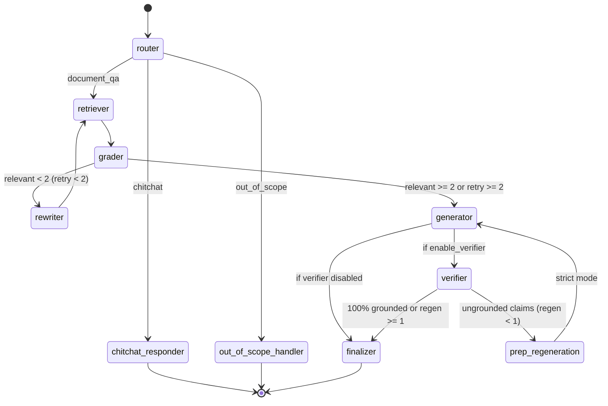

# Chapter 2: Agentic Pipeline & StateGraph Implementation

## 1. Overview of the StateGraph Pattern

Traditional RAG implementations follow an open-loop linear pipeline:
$$\text{Query} \longrightarrow \text{Embedding} \longrightarrow \text{Top-}k \text{ Chunks} \longrightarrow \text{Prompt} \longrightarrow \text{Answer}$$

If the retrieval fails to find the right chunk, or if the chunks contain irrelevant text, the answer fails silently or hallucinates.

**MedDoc Intelligence** implements a **Closed-Loop Cyclic State Graph** via LangGraph. Each step is modeled as a state transformation node on a shared `AgentState` object:



---

## 2. Agent Node Deep Dives

### 2.1 Router Agent (`app/agents/router.py`)
- **System Prompt**: `ROUTER_SYSTEM`
- **Temperature**: `0.0`
- **Objective**: Performs tri-modal intent classification before vector searching:
  - `document_qa`: Valid clinical questions (e.g., *"What are first-line anti-hypertensives in diabetics?"*)
  - `chitchat`: Greetings and general conversational remarks (e.g., *"Hello", "Thanks"*)
  - `out_of_scope`: Disallowed queries (e.g., *"Tell me how much medication to take for my chest pain"*)
- **Routing Decision**:
  ```python
  def route_from_router(state: AgentState) -> str:
      return state.get("route", "document_qa")
  ```

### 2.2 Query Rewriter Agent (`app/agents/rewriter.py`)
- **System Prompt**: `REWRITER_SYSTEM`
- **Temperature**: `0.0`
- **Objective**: Transforms ambiguous, conversation-dependent, or shorthand queries into standalone clinical search queries.
- **Rules**:
  1. Expands acronyms (*HTN* $\rightarrow$ *hypertension*, *MI* $\rightarrow$ *myocardial infarction*).
  2. Resolves pronouns referencing previous chat messages.
  3. Strips conversational filler to maximize dense vector cosine similarity.

### 2.3 Retriever Agent (`app/agents/retriever.py`)
- **Mechanism**: Invokes local FAISS vector store.
- **Search Type**: Maximal Marginal Relevance (MMR).
- **Configuration**:
  - `fetch_k = 20` (Candidate search horizon)
  - `top_k = 8` (Final diversified document set)
  - `lambda_mult = 0.7` (Balance between query relevance and chunk diversity)

### 2.4 Relevance Grader Agent (`app/agents/grader.py`)
- **System Prompt**: `BATCH_GRADER_SYSTEM`
- **Temperature**: `0.0`
- **Execution Mode**: Evaluates all candidate chunks in a single batch JSON call to reduce round-trip latency.
- **Decision Logic**:
  ```python
  def should_retry_or_continue(state: AgentState) -> str:
      relevant = state.get("relevant_docs", [])
      retries = state.get("rewrite_count", 0)
      if len(relevant) < 2 and retries < 2:
          return "rewrite"
      return "generate"
  ```

### 2.5 Answer Generator Agent (`app/agents/generator.py`)
- **System Prompt**: `GENERATOR_SYSTEM` (or `GENERATOR_SYSTEM_STRICT` during retries)
- **Temperature**: `0.2`
- **Objective**: Generates structured clinical synthesis with inline `[Source: <filename>, p.<page>]` citations.
- **Features**:
  - Extracts full un-truncated text snippets from retrieved documents into `citations` for the UI evidence drawer.
  - Prevents appending redundant text blocks at the bottom, keeping answers clean and readable.

### 2.6 Groundedness Verifier Agent (`app/agents/verifier.py`)
- **System Prompt**: `VERIFIER_SYSTEM`
- **Temperature**: `0.0`
- **Evaluation Schema**:
  ```json
  {
    "grounded": true,
    "ungrounded_claims": [],
    "reason": "All bullet points verified in guidelines p.10"
  }
  ```
- **Self-Correction Trigger**:
  ```python
  def should_regenerate_or_finish(state: AgentState) -> str:
      is_grounded = state.get("is_grounded", True)
      regens = state.get("regeneration_count", 0)
      if not is_grounded and regens < 1:
          return "regenerate"
      return "finalize"
  ```
