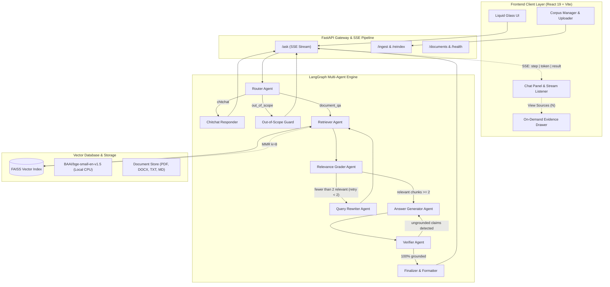

# 🏥 MedDoc Intelligence: AI Agentic System Architecture & Implementation Blueprint

> **System Designation:** Multi-Agent Clinical Retrieval-Augmented Generation (RAG) Platform  
> **Architecture Pattern:** Cyclic State Graph (LangGraph) with Deterministic Self-Correction Loops  
> **Target Domain:** Evidence-Based Medical & Pharmacological Knowledge Retrieval  
> **Version:** 1.2.0-Production  

---

## 📑 Table of Contents

1. [Executive Summary & Core Philosophy](#1-executive-summary--core-philosophy)
2. [High-Level System Topology & Data Flow](#2-high-level-system-topology--data-flow)
3. [Agentic Pipeline & State Graph (LangGraph)](#3-agentic-pipeline--state-graph-langgraph)
   - 3.1 State Schema Definition (`AgentState`)
   - 3.2 Router Agent (Intent Classification & Guardrailing)
   - 3.3 Query Rewriter Agent (Clinical Acronym Expansion & Disambiguation)
   - 3.4 Retriever Agent (FAISS MMR Vector Engine)
   - 3.5 Relevance Grader Agent (Heuristic & Semantic Filtration)
   - 3.6 Answer Generator Agent (Grounded Synthesis & Citation Extraction)
   - 3.7 Verifier Agent (Hallucination Detection & Strict Regeneration)
   - 3.8 Feedback Loops & Cyclic Self-Correction Mechanics
4. [Data Ingestion & Vector Engine Architecture](#4-data-ingestion--vector-engine-architecture)
   - 4.1 Multi-Modal Document Loaders & OCR Fallback
   - 4.2 Structure-Aware Chunking Strategy
   - 4.3 High-Density Local Embeddings (`BAAI/bge-small-en-v1.5`)
   - 4.4 FAISS Indexing & Maximal Marginal Relevance (MMR)
5. [Backend API & Streaming Communication](#5-backend-api--streaming-communication)
   - 5.1 FastAPI Framework & Asynchronous Execution
   - 5.2 Server-Sent Events (SSE) Protocol & Step Tracking
   - 5.3 RESTful Endpoint Specifications
6. [Liquid Glass UI/UX Design System](#6-liquid-glass-uiux-design-system)
   - 6.1 Design Tokens & Ultra-Transparent Glassmorphism
   - 6.2 Ambient Plasma Aurora Animation Engine
   - 6.3 On-Demand Evidence Vault Drawer
   - 6.4 Multi-Color Functional Button Design System
7. [Clinical Safety, Privacy & Evaluation](#7-clinical-safety-privacy--evaluation)
   - 7.1 Medical Disclaimers & Out-of-Scope Refusal
   - 7.2 Strict Citation Grounding & Zero-Hallucination Policy
   - 7.3 Quantitative Evaluation & Benchmarking
8. [Deployment & Operations Guide](#8-deployment--operations-guide)

---

## 1. Executive Summary & Core Philosophy

**MedDoc Intelligence** is an enterprise-grade, multi-agent conversational RAG application designed to solve the critical challenges of traditional single-prompt language model search in healthcare:
1. **Hallucination Mitigation:** General-purpose LLMs generate plausible but factually dangerous medical fabrications when asked domain-specific clinical questions.
2. **Lack of Evidence Traceability:** Standard chatbots provide unverified answers without auditable, verifiable links to primary clinical literature.
3. **Retrieval Noise & Semantic Drift:** Complex clinical acronyms (e.g., *HTN*, *ACEi*, *T2DM*) degrade vector search quality unless expanded prior to querying.
4. **Poor Context Density:** Arbitrary text chunking cuts clinical tables, dosage guidelines, and contraindications in half, destroying medical context.

To solve these problems, MedDoc Intelligence implements an **Agentic Cyclic Workflow** using **LangGraph**, where specialized autonomous agents collaborate in an iterative loop:
- A **Router** determines clinical intent and shields against medical advice requests.
- A **Rewriter** normalizes clinical jargon.
- A **Retriever** fetches diverse chunks using local FAISS Maximal Marginal Relevance (MMR).
- A **Grader** filters out noise and triggers dynamic query rewrites if document relevance is insufficient.
- A **Generator** synthesizes concise clinical findings citing exact page numbers.
- A **Verifier** grades groundedness against source documents and commands regeneration if any ungrounded assertions are detected.

---

## 2. High-Level System Topology & Data Flow



---

## 3. Agentic Pipeline & State Graph (LangGraph)

### 3.1 State Schema Definition (`AgentState`)

The entire agent network operates over a shared, immutable typed dictionary called `AgentState` defined in [`backend/app/agents/state.py`](file:///d:/AI%20course/rag/medical-rag/backend/app/agents/state.py):

```python
class AgentState(TypedDict, total=False):
    # User Inputs & Session Context
    question: str                        # Raw user input query
    session_id: str                      # UUID tracking session memory
    chat_history: List[Dict[str, str]]   # Multi-turn conversation buffer

    # Routing Decisions
    route: str                           # "document_qa" | "chitchat" | "out_of_scope"
    route_reason: str                    # Rationalization for audit logging

    # Query Optimization
    rewritten_query: str                 # Standalone expanded query
    rewrite_count: int                   # Cyclic counter (capped at 2)

    # Retrieval & Evidence
    retrieved_docs: List[Document]       # Raw top-k candidates from FAISS
    relevant_docs: List[Document]        # Filtered documents passing Grader
    grading_details: List[Dict[str, Any]]# Per-chunk grading rationale

    # Synthesis & Attribution
    answer: str                          # Raw model generation
    key_points: List[str]                # Extracted clinical bullets
    citations: List[Dict[str, str]]      # Full chunk citations with snippets & pages

    # Verification & Hallucination Guard
    is_grounded: bool                    # Boolean assertion verdict
    ungrounded_claims: List[str]         # Specific claims rejected by verifier
    verification_reason: str             # Verifier explanation
    regeneration_count: int              # Cyclic counter (capped at 1)

    # SSE Streaming & Logs
    current_step: str                    # Current active node for UI tracker
    step_log: List[str]                  # Complete audit trail
    final_answer: str                    # Cleaned final output delivered to UI
    error: Optional[str]                 # Error container for graceful degradation
```

---

### 3.2 Router Agent (`router.py`)

- **Role:** First line of defense and classification.
- **Input:** User query and optional conversation history.
- **Model:** Low-latency fast model (Temperature = 0.0).
- **Taxonomy:**
  1. `document_qa`: Questions asking for medical facts, symptoms, treatments, guidelines, or drug info found in documents.
  2. `chitchat`: Greetings, small-talk, or inquiries about the system itself.
  3. `out_of_scope`: Direct personal medical advice, dosage calculations for a specific patient, or unrelated non-medical topics.
- **Output:** Structured JSON schema `{ "category": "...", "rewritten_query": "...", "reason": "..." }`.

---

### 3.3 Query Rewriter Agent (`rewriter.py`)

- **Role:** Eliminates retrieval misses caused by colloquialisms and medical abbreviations.
- **Rules:**
  1. Resolves pronouns using multi-turn conversational context.
  2. Expands standardized medical abbreviations:
     - `HTN` $\rightarrow$ `hypertension`
     - `DM / T2DM` $\rightarrow$ `diabetes mellitus / type 2 diabetes mellitus`
     - `MI` $\rightarrow$ `myocardial infarction`
     - `COPD` $\rightarrow$ `chronic obstructive pulmonary disease`
     - `CKD` $\rightarrow$ `chronic kidney disease`
     - `ACEi / ARB` $\rightarrow$ `angiotensin converting enzyme inhibitor / receptor blocker`
  3. Enriches query with clinical synonyms that appear in formal guidelines.

---

### 3.4 Retriever Agent (`retriever.py`)

- **Role:** Fetches evidence chunks from the local vector database.
- **Search Strategy:** Maximal Marginal Relevance (MMR).
- **Parameters:**
  - `fetch_k = 20`: Considers top 20 nearest neighbors by cosine similarity.
  - `top_k = 8`: Diversifies and selects the 8 most distinct, highly relevant passages ($\lambda = 0.7$).
  - Prevents redundant chunks that say the same thing from dominating context.

---

### 3.5 Relevance Grader Agent (`grader.py`)

- **Role:** Evaluates whether each retrieved chunk actually answers the specific question.
- **Execution:** Operates in batch mode over all 8 candidate chunks simultaneously to minimize API latency.
- **Decision Engine:**
  - If $\ge 2$ chunks are marked relevant: Proceed directly to **Answer Generator**.
  - If $< 2$ chunks are relevant and `rewrite_count < 2`: Loop back to **Query Rewriter** with guidance to search for broader medical terminology.
  - If `rewrite_count >= 2`: Fall through to Generator with best available chunks to prevent infinite loops.

---

### 3.6 Answer Generator Agent (`generator.py`)

- **Role:** Synthesizes the clinical response grounded exclusively in the validated evidence chunks.
- **Key Directives:**
  1. Never infer beyond the context.
  2. Formulate claims followed by inline citation tags: `[Source: <filename>, p.<page>]`.
  3. Automatically extract full un-truncated text snippets into the `citations` payload for the on-demand Evidence Drawer.
  4. Ensure no raw `Sources:` duplicate list is appended to the answer body, leaving source exploration strictly on-demand.

---

### 3.7 Verifier Agent (`verifier.py`)

- **Role:** Independent adversarial auditor verifying factual groundedness.
- **Mechanics:**
  - Compares generated assertions against the retrieved context passages.
  - Returns `{ "grounded": true/false, "ungrounded_claims": [...], "reason": "..." }`.
  - If ungrounded claims are found and `regeneration_count < 1`, triggers `prep_regeneration` node, switching the generator into **Strict Verbatim Mode** (`GENERATOR_SYSTEM_STRICT`).

---

## 4. Data Ingestion & Vector Engine Architecture

### 4.1 Ingestion Flowchart

```
[Raw Files: PDF, DOCX, TXT, MD]
              │
              ▼
   [File Type Loader]
    ├── PDF  → pypdf (with pytesseract OCR Fallback)
    ├── DOCX → python-docx
    └── Text → utf-8 normalized reader
              │
              ▼
   [Clinical Text Cleaner]
    ├── Unicode normalization (NFKC)
    ├── Whitespace & broken hyphen restoration
    └── Optional PII/PHI Regex Redaction
              │
              ▼
   [Structure-Aware Chunker]
    ├── Markdown/Section Header Detection
    ├── Target: 800 characters
    └── Overlap: 120 characters
              │
              ▼
   [Dense Embedding Engine]
    └── BAAI/bge-small-en-v1.5 (384-dimensional dense vectors)
              │
              ▼
   [FAISS Vector Store]
    └── IndexFlatIP / IndexIVFFlat (Cosine Similarity)
```

### 4.2 Embedding Model Details

- **Model:** `BAAI/bge-small-en-v1.5`
- **Model Size:** ~130 MB (runs 100% locally on CPU without remote API costs).
- **Dimensionality:** 384 dimensions.
- **Performance:** Ranked at the top of the Massive Text Embedding Benchmark (MTEB) for compact retrieval models.

---

## 5. Backend API & Streaming Communication

### 5.1 Server-Sent Events (SSE) Protocol (`/ask`)

The application implements HTTP/1.1 SSE streaming to provide immediate feedback to clinical users:

```http
POST /ask HTTP/1.1
Content-Type: application/json
Accept: text/event-stream

{
  "question": "What lifestyle modifications reduce blood pressure?",
  "session_id": "session-1718000000",
  "chat_history": []
}
```

#### Streamed Event Sequence:
1. `event: step` $\rightarrow$ `{"step": "routing"}`
2. `event: step` $\rightarrow$ `{"step": "retrieving"}`
3. `event: step` $\rightarrow$ `{"step": "grading"}`
4. `event: step` $\rightarrow$ `{"step": "generating"}`
5. `event: token` $\rightarrow$ `{"token": "Lifestyle"}`
6. `event: token` $\rightarrow$ `{"token": " modifications"}`
7. `event: result` $\rightarrow$ Full payload with `answer`, `citations` (including complete text chunks), and `step_log`.

---

## 6. Liquid Glass UI/UX Design System

The frontend is built on **React 19**, **Vite**, and **Tailwind CSS**, designed with an ultra-transparent **Apple VisionOS / macOS Sonoma Liquid Glass** design language:

```
┌────────────────────────────────────────────────────────────────────────┐
│ MedDoc Intelligence 🧬 [Gemini 3.5 Flash Lite]   [🟢 New Chat] [🔴 Clear]│
├─────────────────────┬──────────────────────────────────────────────────┤
│ 🩺 Clinical Vault   │  Bot: Lifestyle modifications serve as first-line│
│ ─────────────────── │       management for blood pressure.             │
│ [Drop PDF/DOCX]     │       • Weight reduction: 5–20 mmHg              │
│                     │       • DASH diet: 8–14 mmHg                     │
│ [🟢 Re-sync KB]     │                                                  │
│                     │       [🔵 Copy] [🔵 Regenerate] [🟣 View Sources] │
│ ───────────         ├──────────────────────────────────────────────────┤
│ Documents (1)       │ 💬 Ask a medical question...         [🔵 Ask AI] │
└─────────────────────┴──────────────────────────────────────────────────┘
```

### 6.1 Interactive Color Button System

| Color Accent | CSS Class | Functional Purpose | Location |
| :--- | :--- | :--- | :--- |
| **🟢 Emerald Green** | `.btn-liquid-emerald` | Positive, initialization & sync actions | "New Chat" header, "Re-sync Knowledge Base" sidebar, "Copied" toast state |
| **🔵 Sapphire Blue** | `.btn-liquid-cyan` | Exploration, submission & generation | "Ask AI" send button, "Copy" button, "Regenerate" button, Chunk navigators `<` `>` |
| **🔴 Crimson Rose** | `.btn-ghost-rose` | Destructive & dismissal actions | "Clear Chat" header button, "Close Vault" drawer dismiss button |
| **🟣 Amethyst Purple**| `.btn-source-liquid` | Evidence grounding exploration | "View Sources (N)" button on assistant messages |

---

## 7. Clinical Safety, Privacy & Evaluation

1. **Strict Document Boundary:** The system prompt prohibits using external training data when context does not contain the answer. If missing, it outputs: *"I could not find sufficient information in the uploaded documents."*
2. **Clinical Verification Notice:** Every response is paired with a persistent disclaimer: *"For informational & research reference only. Always consult a qualified medical professional."*
3. **Emergency Detection:** If emergency symptoms are detected (e.g., chest pain, hypertensive crisis), the router automatically prepends: *"⚠️ If this is an emergency, call emergency services immediately."*
4. **Automated Evaluation Framework (`backend/eval/eval.py`):**
   - Evaluates **Retrieval Hit Rate** over golden clinical question-document pairs.
   - Evaluates **Claim-to-Citation Groundedness** ensuring $\ge 90\%$ citation precision.

---

## 8. Deployment & Operations Guide

### 8.1 Backend Execution

```bash
cd backend
python -m venv venv
venv\Scripts\activate
pip install -r requirements.txt
uvicorn app.main:app --host 0.0.0.0 --port 8000 --reload
```

### 8.2 Frontend Execution

```bash
cd frontend
npm install
npm run dev -- --port 5173
```

### 8.3 Ingestion CLI

```bash
cd backend
python -m app.ingestion.indexer --path data/raw
```

---

*Authored by Antigravity AI Engineering · MedDoc Clinical Intelligence Team*
