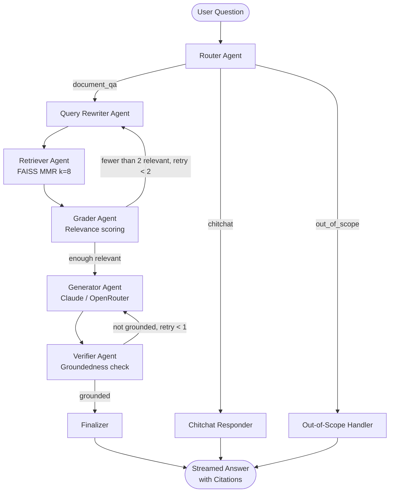

# 🏥 Medical Document RAG

A production-quality, **multi-agent RAG (Retrieval-Augmented Generation)** application for querying medical documents with grounded, cited answers.

**Stack:** FastAPI · LangChain · LangGraph · FAISS · OpenRouter · React · Vite · Tailwind CSS

---

## Architecture



---

## Project Structure

```
medical-rag/
├── backend/
│   ├── app/
│   │   ├── main.py              # FastAPI app, CORS, routers
│   │   ├── config.py            # pydantic-settings, loads .env
│   │   ├── llm.py               # OpenRouter ChatOpenAI factory
│   │   ├── prompts.py           # All prompts (versioned)
│   │   ├── api/                 # Routes: /ingest, /ask (SSE), /documents, /health
│   │   ├── ingestion/
│   │   │   ├── loaders.py       # PDF, DOCX, TXT, MD loaders + OCR
│   │   │   ├── cleaner.py       # Text normalization
│   │   │   ├── chunker.py       # Structure-aware chunking
│   │   │   └── indexer.py       # FAISS build/update + CLI
│   │   └── agents/
│   │       ├── state.py         # LangGraph TypedDict state
│   │       ├── router.py        # Query router
│   │       ├── rewriter.py      # Query rewriter
│   │       ├── retriever.py     # FAISS retrieval
│   │       ├── grader.py        # Relevance grader
│   │       ├── generator.py     # Answer generator
│   │       ├── verifier.py      # Groundedness verifier
│   │       └── graph.py         # LangGraph assembly
│   ├── data/raw/                # Input medical documents
│   ├── data/faiss_index/        # Persisted FAISS index
│   ├── tests/                   # pytest unit tests
│   ├── eval/eval.py             # Retrieval + groundedness evaluation
│   ├── requirements.txt
│   └── .env.example
├── frontend/                    # React + Vite + Tailwind
└── README.md
```

---

## Setup

### Prerequisites
- Python 3.11+
- Node.js 18+
- An [OpenRouter](https://openrouter.ai) API key

---

### 1. Clone & Configure

```bash
cd medical-rag/backend
cp .env.example .env
```

Edit `.env` and set your `OPENROUTER_API_KEY`.

---

### 2. Install Backend

```bash
cd medical-rag/backend
python -m venv venv
# Windows:
venv\Scripts\activate
# macOS/Linux:
source venv/bin/activate

pip install -r requirements.txt
```

> **Note:** The first run downloads the embedding model `BAAI/bge-small-en-v1.5` (~130 MB, CPU-only).

---

### 3. Ingest Documents

Place your PDF/DOCX/TXT/MD files in `backend/data/raw/`, then run:

```bash
cd backend
python -m app.ingestion.indexer --path data/raw
```

A sample hypertension guidelines document is already included.

**CLI options:**
```
--path data/raw      # Index all files in directory
--file path/to.pdf   # Index a single file
--reindex            # Full re-index (clears existing)
```

---

### 4. Run the Backend

```bash
cd backend
uvicorn app.main:app --reload --host 0.0.0.0 --port 8000
```

API docs: http://localhost:8000/docs

---

### 5. Run the Frontend

```bash
cd frontend
npm install
npm run dev
```

Open: http://localhost:5173

---

## API Reference

| Method | Endpoint | Description |
|--------|----------|-------------|
| `GET`  | `/health` | Health check |
| `GET`  | `/documents` | List indexed documents |
| `POST` | `/ingest` | Upload & index a file |
| `POST` | `/ingest/reindex` | Re-index all documents |
| `POST` | `/ask` | Ask a question (SSE streaming) |

### SSE Event Types (`/ask`)

```
event: step    → {"step": "routing"|"rewriting"|"retrieving"|"grading"|"generating"|"verifying"}
event: token   → {"token": "..."}         (incremental answer tokens)
event: result  → {answer, citations, key_points, step_log, session_id}
event: error   → {"error": "..."}
```

---

## Multi-Agent Pipeline

| Agent | Model | Purpose |
|-------|-------|---------|
| **Router** | Fast model (temp=0) | Classify: document_qa / chitchat / out_of_scope |
| **Rewriter** | Fast model (temp=0) | Expand abbreviations, standalone query |
| **Retriever** | — | FAISS MMR search, top-k=8 |
| **Grader** | Fast model (temp=0) | Score chunk relevance (JSON output) |
| **Generator** | Main model (temp=0.2) | Grounded answer with citations |
| **Verifier** | Fast model (temp=0) | Groundedness check (JSON output) |

---

## Configuration (`.env`)

```ini
OPENROUTER_API_KEY=sk-or-v1-...
OPENROUTER_MODEL=anthropic/claude-sonnet-4-5
OPENROUTER_FAST_MODEL=anthropic/claude-haiku-4-5
EMBEDDING_MODEL=BAAI/bge-small-en-v1.5   # fully local, no API key
RETRIEVAL_TOP_K=8
CHUNK_SIZE=800
CHUNK_OVERLAP=120
ENABLE_PII_MASKING=false
```

---

## Privacy & Safety

- **No PHI transmitted by default.** Retrieved document chunks are sent to OpenRouter for generation. If documents contain PHI, enable `ENABLE_PII_MASKING=true` and implement redaction in `cleaner.py`.
- The system prompts explicitly prevent personal diagnosis or prescription advice.
- All answers include a medical disclaimer.

---

## Running Tests

```bash
cd backend
pytest tests/ -v
```

### Evaluation

```bash
cd backend
python eval/eval.py
```

Reports retrieval hit rate and heuristic groundedness over 10 Q&A pairs.

---

## Test Question

After ingesting the sample document, try:

> **"What blood pressure medications are contraindicated in pregnancy?"**

Expected: Answer citing ACE inhibitors and ARBs, referencing the hypertension guidelines document.

---

## License

MIT
